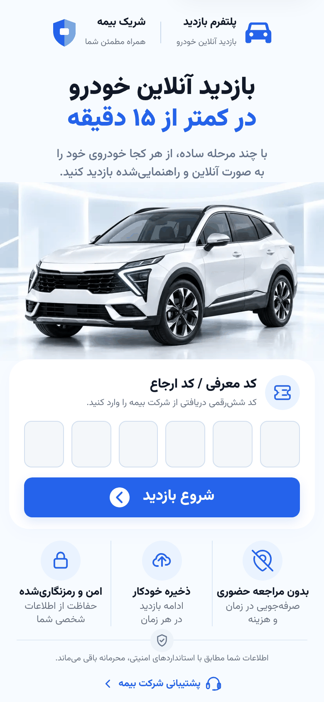
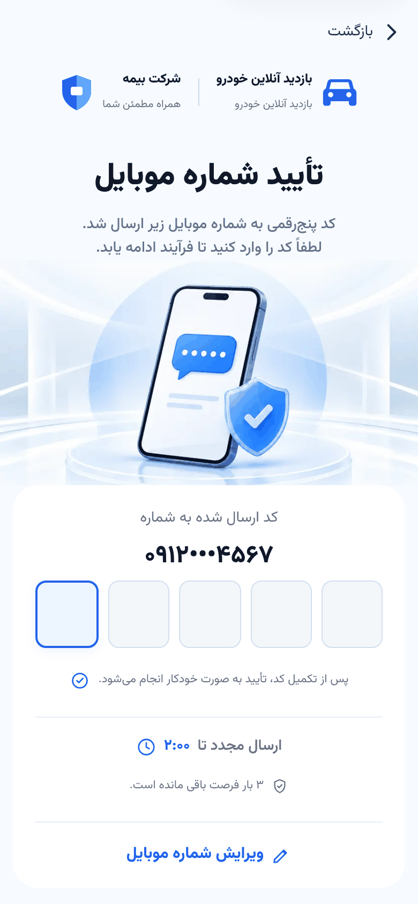
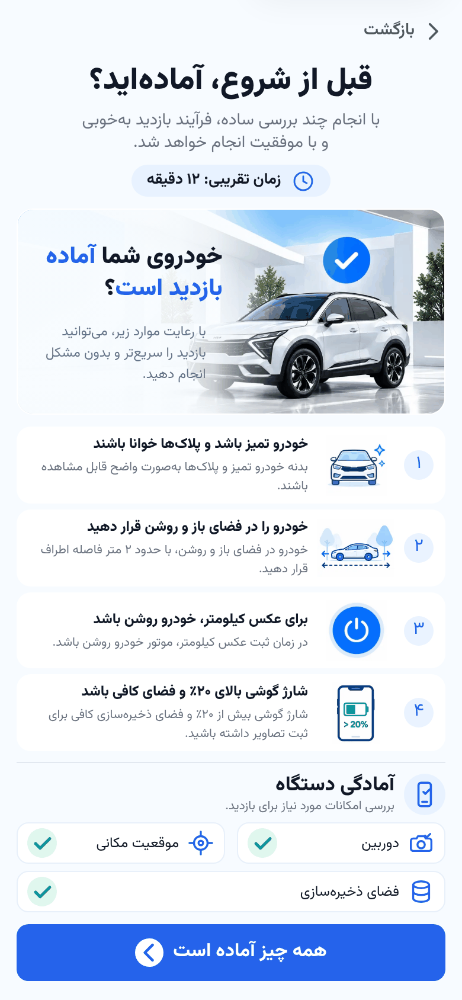
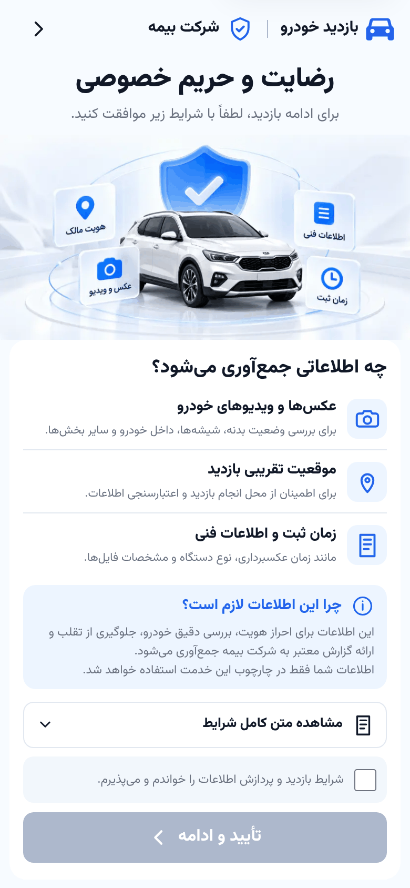
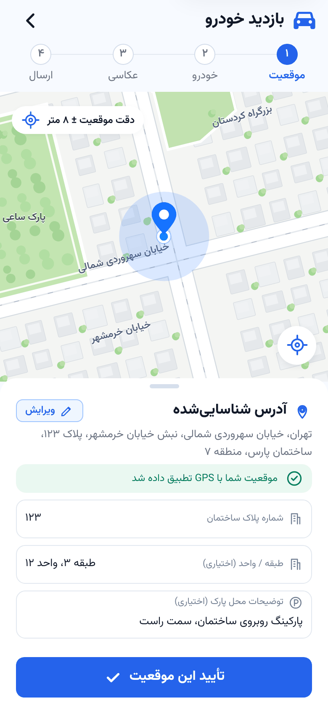
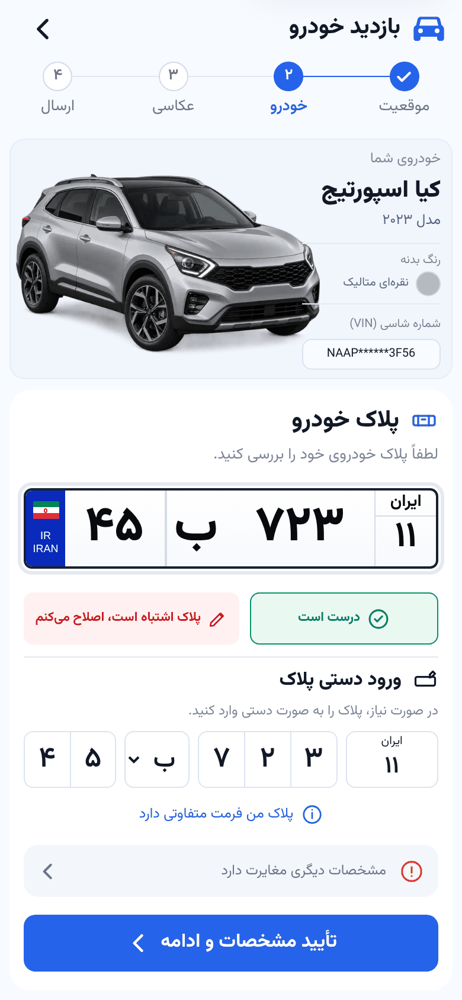
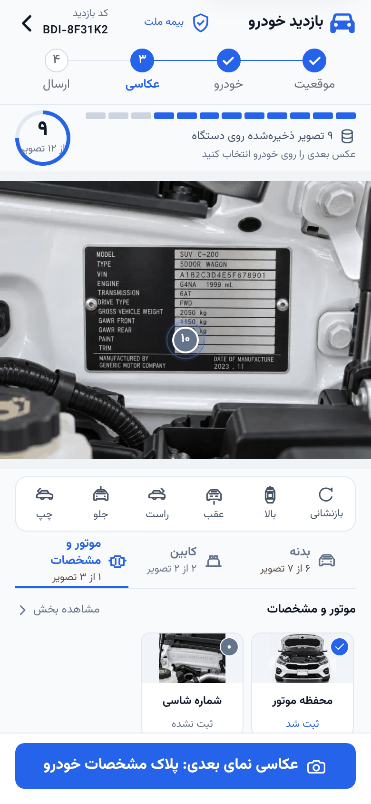
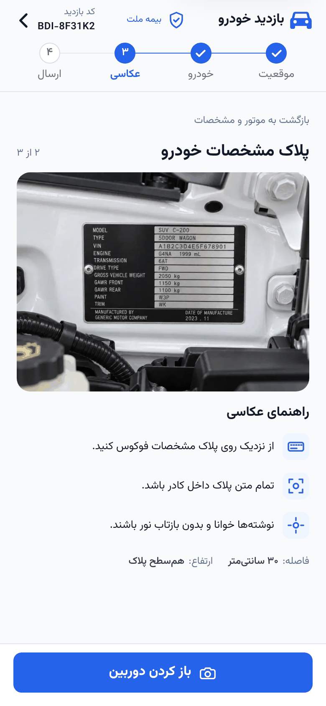

# Vehicle Inspection — Customer Web App

A mobile-first, Persian (RTL) web app that lets car owners complete an insurance vehicle inspection on their own phone in under 15 minutes. It guides them step by step: verify their identity, confirm the car's location and details, take 12 guided photos, enter the odometer reading, record a walk-around video, then upload and submit everything for review.

اپلیکیشن تحت وب بازدید آنلاین خودرو: احراز هویت با کد یک‌بارمصرف، تأیید موقعیت و مشخصات خودرو، عکاسی راهنمایی‌شده، ثبت کیلومتر و ویدیوی ۳۶۰ درجه، و ارسال برای کارشناس.

> Runs entirely on **mock data**, so no backend is needed to try it.

## Screenshots

| Landing | OTP verification | Readiness check | Consent |
| --- | --- | --- | --- |
|  |  |  |  |
| **Location** | **Vehicle identity** | **Photo capture** | **Photo guide** |
|  |  |  |  |

## Features

- **Referral code and OTP sign-in:** the customer enters the 6-digit code from their insurer, then verifies their mobile number with a 5-digit code, with a resend timer and limited attempts.
- **Readiness and consent:** a checklist before starting and a live check of the camera, location and storage, then a consent step that explains what data is collected and why.
- **Location and vehicle identity:** confirm the inspection address from GPS and check the car's model, VIN and a Persian license plate, with manual plate entry if needed.
- **Guided photography:** 12 required photos in 7 sections (exterior, cabin, engine). Each shot has a sample image, instructions, the right distance and height, and status markers placed directly on the car picture. Customers can review, keep or retake every photo.
- **Odometer and 360° video:** a numeric odometer entry and a continuous walk-around video recording.
- **Upload Center:** photos and video are saved in the browser (IndexedDB) and uploaded through a queue that survives page reloads and retries after the connection drops.
- **Review, submit and receipt:** a final summary of everything collected, then a submission receipt with a reference number.
- **Additional evidence:** when a reviewer asks for a retake, the customer can replace only the requested photo or video without changing the original submission.

## Tech stack

- **Next.js 16** (App Router) · **React 19** · **TypeScript**
- **Tailwind CSS 4** with a custom design system: tokens, icons and shared UI components
- **TanStack Query** for server state · **Zustand** for workflow state
- **React Hook Form** + **Zod** for forms and validation
- **IndexedDB** for storing photos and video on the device
- **Vitest** + **Testing Library** for unit tests · **Playwright** for end-to-end and visual tests
- Persian RTL throughout, with the Vazirmatn font and Persian digits

## Run it locally

You need [Node.js](https://nodejs.org) 20 or newer.

```sh
git clone https://github.com/AliKeramattii/vehicle-inspection-frontend.git
cd vehicle-inspection-frontend
npm ci
npm run dev
```

Open <http://localhost:3000>. The app is designed for phones, so for the best view open Chrome DevTools (F12), turn on device mode (Ctrl+Shift+M) and pick a phone size.

### Demo walkthrough

| Step | What to enter |
| --- | --- |
| Referral code (landing page) | `A4K9P2` |
| Verification code | `12345` |
| Demo mobile number | `09120004567` (you can change it on the OTP screen) |

The camera steps need a real camera. On a laptop, Chrome uses the webcam. To test on your phone, open the address that `npm run dev` prints for your local network. The dev server listens on all network interfaces.

### Scripts

| Command | What it does |
| --- | --- |
| `npm run dev` | Start the development server |
| `npm run build` | Build for production |
| `npm run lint` | Run ESLint |
| `npm run typecheck` | Check TypeScript types |
| `npm test` | Run unit tests (Vitest) |
| `npm run test:e2e` | Run end-to-end tests (Playwright); run `npx playwright install chromium` once first |

## Project structure

```
src/
  app/(customer)/     pages for the customer flow: landing, verify, readiness, consent, inspection/*
  features/           one folder per feature: auth, consent, location, vehicle, photography,
                      capture, upload, submission, additional-evidence, …
  components/         shared UI components
  lib/                media storage (IndexedDB), helpers
  mocks/              mock repositories and demo data
  schemas/            Zod schemas
  stores/             Zustand stores
tests/                unit and Playwright end-to-end tests
docs/                 architecture and feature notes
```

## My role

I built this app during my frontend internship at [Balaban](https://mybalaban.org) (summer 2026):

- Designed the user flows and visual assets for location, vehicle details, photo upload and document review.
- Built the interface with React and Next.js with the help of an AI coding assistant (Codex). I designed the flows, reviewed and corrected the generated code, and tested every screen in the browser.

## Status

The customer flow is complete on mock data. The reviewer and admin areas, the real backend connection and the optional 3D vehicle view are planned for later.
