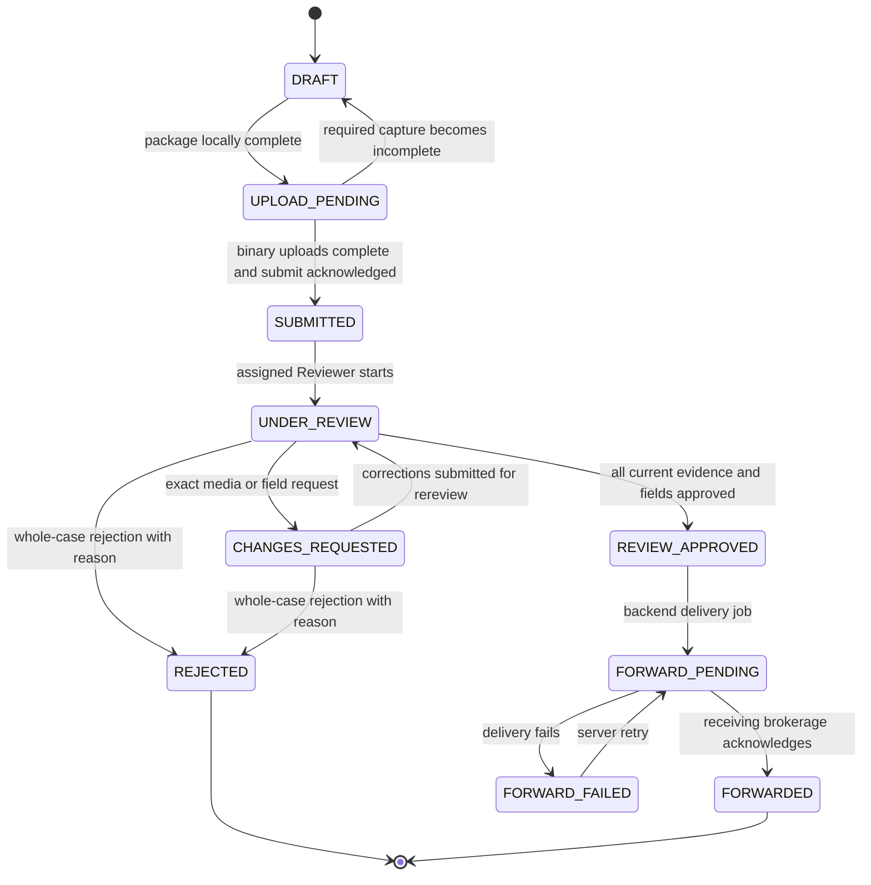

# Inspection state machine

Business projection: features/inspection-status/lifecycle-model.ts; existing capture/upload/submission/request enums remain persisted unchanged. Local authoritative transitions use existing repositories; production must provide authenticated versioned status. Mock fixture seeding may jump to demonstrate a state; it is not an allowed production transition.

## Definitions and transition authority
| State | Required meaning / authority | Returning screen |
|---|---|---|
| DRAFT | Confirmed facts or capture incomplete; customer/local helper | Saved safe step or readiness/location/vehicle/capture |
| UPLOAD_PENDING | Existing capture-package helper complete; binary media may still be queued | Upload Center |
| SUBMITTED | Durable submit receipt exists; no whole decision | Tracking receipt |
| UNDER_REVIEW | Assigned staff review; no final decision | Tracking/status; supplemental rereview timeline retained |
| CHANGES_REQUESTED | Named media and/or plate/color/year task with public reason | Exact request list or receipt field editor |
| REJECTED | Assigned whole decision with full customer reason | Reason and explicit new-attempt confirmation |
| REVIEW_APPROVED | Separate assigned whole approval; required current revisions/fields approved | Approved, delivery not yet confirmed |
| FORWARD_PENDING | Backend sending/retrying; no acknowledgement | Delivery pending |
| FORWARDED | Backend validated acknowledgement ID and time | Confirmed reviewed/approved/delivered |
| FORWARD_FAILED | Approved case delivery failure | Delivery failure, no recapture |

SUBMITTED/CHANGES_REQUESTED may be fully rejected by the assigned Reviewer after appropriate case loading; simple assignment changes never approve a case. A new attempt after REJECTED is a new inspectionId with previousAttemptId, same source request, empty media/data namespace and its own tracking. It is not REJECTED → DRAFT on the old record.

## Independent dimensions
Capture: pending/draft/accepted/retake for each requirement, with replacement attention separate from accepted credit. Odometer numeric completion is separate. Upload: local/queued/uploading/uploaded/failed/cancelled. Verification: not-started/processing/verified/retake-requested. Reviewer: current revision's approved/rejected decision plus separate whole decision. Delivery: ready/sending/retrying/failed/acknowledged. None of these alone means the others are complete.

Submit uses existing derived capture-package/readiness helpers: required accepted photos, valid numeric kilometers, accepted video, confirmed facts and all required current binary uploads complete. Uploaded+processing counts as binary-uploaded, never verified. Failed/queued/uploading blocks submit. Receipt creation is idempotent and durable; offline blocks formal submission rather than claiming background success.

## Forbidden transitions and protections
- No saved data, tracking string, URL role/phone/tenant or unverified session grants identity.
- No individual upload/evidence decision jumps to whole approval or brokerage delivery.
- No accepted evidence reset for an unrelated correction; no original-to-new-attempt copy after rejection.
- No correction/edit after final decision through the ordinary flow; future additional-evidence-after-final policy needs explicit backend transitions.
- Late capture reconciliation changes only DRAFT/UPLOAD_PENDING. Late pre-final staff projection cannot reopen REJECTED, REVIEW_APPROVED, forwarding states or FORWARDED. Delivered and rejected are terminal for the current scope. Failed delivery can retry; it cannot downgrade to photography or reviewer approval.
- New field requests/approval are blocked against final lifecycle states. Finalized Reviewer case evidence cannot be mutated by background replacement synchronization.

## Revision/concurrency requirements
Request scope pins inspection/template/version/requirement and exact original evidence. The latest acknowledged request round for each target determines the current revision, independent of IndexedDB/job order. Only receipt-listed job IDs in that request namespace qualify. Superseded/unacknowledged/foreign jobs do not qualify. Archived revisions cannot replay over current data; metadata history does not duplicate Blobs.

The backend must use expectedVersion/ETag CAS, stable command IDs and server actor/time on every decision, correction, new-attempt and delivery transition. Reject stale versions with conflict and reload current state. Multiple browser databases are not a cross-service transaction; production outbox/transaction guarantees are still required. Failure/retry never deletes accepted media. Audit records and finalized snapshots remain immutable under the future retention policy.

## Current photo policy v2

New capture readiness derives eleven logical photographs: ten mandatory fixed slots and one valid VIN/spec alternative. Selecting a guide or creating a draft is not completion. Accepted A retains its completion credit while B is pending; confirmation atomically promotes B and invalidates obsolete upload revisions. Retake attention, upload completion and Reviewer approval remain separate. The existing exact-item correction namespace opens only that requested logical group, not its three unused alternatives or unrelated fields. Frozen twelve-photo v1 submissions remain locked/readable. See PHOTO_REQUIREMENT_POLICY_V2.md for IDs, pins and proposed API metadata.
