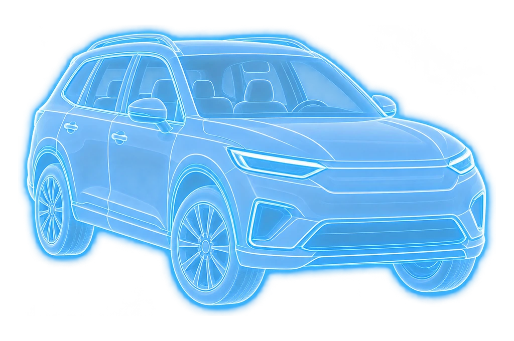

# راهنمای کامل طراحی و پیاده‌سازی ضبط ۳۶۰ درجه خودرو

## A. طراحی کلی

هدف ساخت یک صفحهٔ موبایل‌فرست (RTL) است که ضبط ویدیوی پیوسته از اطراف خودرو را بدون استفاده از گالری و فایل‌های آماده ممکن کند. پوستهٔ اپلیکیشن روشن و هم‌راستا با رابط بازدید خودرو طراحی شده است و بخش دوربین تیره است تا تصویر خودرو برجسته بماند. رنگ آبی اصلی `#2563EB` به دکمه شروع، حلقه زمان و نشانه‌های راهنما اختصاص دارد؛ قرمز فقط برای ضبط فعال و خطا، و سبز برای موفقیت استفاده می‌شود.

ترتیب دیداری: هدر → دستور یک‌خطی → پیش‌نمایش بزرگ دوربین → حلقه پیشرفت زمان → سه نکته تصویربرداری → کنترل‌های ضبط. این ترکیب بدون کارت‌های عظیم، نوارهای تزئینی اضافه یا WebGL و داخل پوسته `100dvh` کار می‌کند. برخلاف یک شات ثابت نمایشی، عنصر `<video>` در اجرای واقعی جریان مستقیم دوربین است و تصویر شفاف WebP به‌صورت لایه روی آن قرار می‌گیرد.

**محدودیت منبع:** اسکرین‌شات اولیه و مخزن کد فعلی همراه این درخواست ارائه نشده‌اند. بنابراین بهبودهای بصری از توضیح نوشتاری و تجربهٔ پروژه استنباط شده‌اند؛ ادعای مقایسه پیکسلی با اصل صفحه یا تست داخل پروژه اصلی وجود ندارد. تصاویر `mockups/concept-*` رندرهای ایده‌پردازی‌اند و اسکرین‌های `mockups/recording-*.png` بازآفرینی تصویری فارسی‌اند؛ این تصاویر **اسکرین‌شات مرورگر نیستند**.

## B. توضیح همه عناصر صفحه

| عنصر | جایگاه و ظاهر | عملکرد و تغییر وضعیت |
|---|---|---|
| دکمه خروج | بالای صفحه، مربع گرد با × | هنگام ضبط تأیید می‌گیرد تا ضبط تصادفی از بین نرود؛ به اپ میزبان event خروج می‌فرستد. |
| عنوان | مرکز هدر، راست‌به‌چپ | عنوان مرحلهٔ بازرسی؛ ثابت در همه وضعیت‌ها. |
| دکمه راهنما | کنار عنوان | متن توضیحات مجوز دوربین، اصول ضبط، حریم و تفاوت زمان با پوشش را باز می‌کند. |
| تیتر وظیفه | زیر هدر | توضیح حرکت پیوسته و آهسته اطراف خودرو. |
| پیش‌نمایش | ناحیه بزرگ و تیره | قبل از مجوز توضیح نمایش می‌دهد؛ بعد از مجوز `HTMLVideoElement.srcObject = MediaStream` می‌شود؛ پس از توقف ویدیوی ضبط‌شده را به‌شکل قابل بازبینی نمایش می‌دهد. |
| نشان وضعیت | گوشه بالای تصویر | آماده / در حال ضبط / مکث / پردازش؛ نقطه قرمز در حالت ضبط ضربان کوتاه دارد. |
| کنترل Ghost | گوشه مقابل نشان وضعیت | راهنمای شفاف را بدون خاموش‌کردن ضبط مخفی/نمایان می‌کند؛ `aria-pressed` را به‌روز می‌کند. |
| قاب گوشه‌دار | روی تصویر زنده | هدف قاب‌بندی بصری است و مزاحم لمس نمی‌شود. |
| خودرو شفاف | وسط تصویر زنده | از یکی از هشت تصویر WebP نسبت‌دار استفاده می‌کند؛ تشخیص خودکار انطباق وجود ندارد. |
| انتخاب زاویه | پایین کادر | با فلش‌های قبلی/بعدی، نمای خودرو عوض می‌شود؛ پیشروی زاویه‌ها دستی است، نه تشخیص تکمیل فیلم‌برداری. |
| حلقه زمان | زیر پیش‌نمایش | طول زمان ثبت‌شده را به مقدار هدف ۶۰ ثانیه نسبت می‌دهد. |
| تایمر | در مرکز حلقه | دقیقه:ثانیهٔ ضبط فعال، به ارقام فارسی. |
| برچسب کیفیت | زیر حلقه | روشن می‌کند که نتیجهٔ حلقه تأیید ۳۶۰ درجه نیست. |
| راهنمای کیفیت | کادر روشن زیر زمان | نور مناسب، ثابت‌نگه‌داشتن دستگاه، حرکت آهسته و قرارگیری عمودی. |
| کنترل شروع | پایین صفحه | فقط پس از روشن شدن دوربین قابل استفاده است؛ فایل‌پیکر یا گالری وجود ندارد. |
| کنترل مکث | هنگام ضبط (اگر پشتیبانی شود) | `MediaRecorder.pause()` و توقف افزایش تایمر. |
| ادامه ضبط | هنگام مکث | `MediaRecorder.resume()` و ادامه زمان از همان مقدار. |
| پایان ضبط | هنگام ضبط/مکث | `MediaRecorder.stop()` و ساخت Blob قابل بازبینی. |
| ضبط مجدد | صفحه بازبینی | ویدیوی موقت را دور می‌اندازد و کاربر باید دوباره از دوربین شروع کند. |
| تأیید و ذخیره | صفحه بازبینی | Blob و metadata در IndexedDB ذخیره و سپس در صورت وجود bridge، به صف آپلود اصلی سپرده می‌شود. |
| پیام ناسازگاری | در خطای مجوز/API | توضیح واضح + تلاش دوباره؛ هرگز فایل‌پیکر جانشین نمی‌شود. |

در نسخهٔ تصویری استاتیک نمونه SUV نقره‌ای برای توضیح طرح آمده است؛ در اجرای واقعی **این نمونه عکس هرگز به جای تصویر زنده دوربین قرار نمی‌گیرد**.

## C. حلقه پیشرفت زمانی

زمان پیشنهادی نمونه `targetDurationMs = 60000` است؛ این مقدار باید با قوانین بک‌اند قابل تنظیم باشد. مقدار حلقه:

```js
percent = Math.min(elapsedActiveRecordingMs / targetDurationMs, 1) * 100;
```

فقط زمانی که MediaRecorder واقعاً در حال ضبط است از ساعت monotonic (`performance.now`) استفاده می‌شود؛ هنگام مکث زمان گذشتۀ فعال ذخیره می‌شود و تا ادامه مجدداً افزایش نمی‌یابد. حلقه با یک SVG شامل دو دایره و تنظیم CSS `stroke-dashoffset` ایجاد می‌شود و انیمیشن خطی کوتاه دارد. در سیستم کاهش حرکت، transition خاموش می‌شود.

حالت‌ها: شروع نشده ۰٪ (خاکستری)، ضبط فعال با حلقه آبی، مکث ثابت، تکمیل زمان پیشنهادی ۱۰۰٪ با امکان ادامه ضبط، اتمام ویدیوی واقعی پس از پایان و بازبینی/تأیید، و خطا با حلقه قرمز. **هرگز با رسیدن به ۱۰۰٪ خودکار ضبط را خاتمه نمی‌دهیم.** اگر کاربر پیش از هدف زمانی به ضبط خاتمه دهد، حالت تکمیل ویدیو نمایش داده می‌شود ولی درصد زمان مثلاً ۵۰٪ باقی می‌ماند. تنها تأیید مشاهده‌ای یا سامانهٔ بینایی‌ماشین معتبر می‌تواند پوشش واقعی را تشخیص دهد؛ این نمونه چنین سیستمی ندارد.

## D. Ghost Guide

راهنما شامل هشت تصویر WebP جداگانه است: جلو، جلو ۴۵ درجه راست، راست، عقب ۴۵ درجه چپ، عقب، عقب ۴۵ درجه راست، چپ و جلو ۴۵ درجه چپ. انتخاب زاویه دستی و با کلیدهای لمسی است؛ توضیحات هر زاویه در پایین تصویر نوشته می‌شود.

ساختار DOM هنگام روشن بودن دوربین:

```html
<div class="camera-stage">
  <div class="preview-root"><video autoplay muted playsinline></video></div>
  <div class="ghost-root">
    <div class="ghost-layer">
      
    </div>
  </div>
</div>
```

`video` با `object-fit:cover` داخل پیش‌نمایش قرار می‌گیرد. Ghost در ناحیه امن با اندازه مقید، `object-fit:contain`, حفظ نسبت WebP و opacity حدود ۴۴٪ نمایش داده می‌شود؛ خود خطوط svg روشن و ملایم هستند. کنترل مخفی‌سازی `opacity:0` را تغییر می‌دهد، نه جریان تصویر را. `pointer-events:none` روی لایه Ghost از جلوگیری تعامل کاربر با کنترل‌ها جلوگیری می‌کند. WebP تنها روی سطح UI قرار دارد و چون `MediaRecorder` از `MediaStream` اولیه ضبط می‌کند، خطوط Ghost داخل Blob نهایی ذخیره نمی‌شوند.

در حالت landscape یک توصیهٔ قابل رؤیت برای نگه‌داشتن گوشی به‌صورت عمودی وجود دارد و راهنما متناسب با ابعاد صفحه کوچک می‌شود؛ اما سمت/پرسپکتیو خودرو به صورت خودکار از دوربین تشخیص داده نمی‌شود. برای صحت هندسی دقیق روی همه دوربین‌ها، لازم است نسبت ابعاد واقعی track و crop `object-fit` را در نسخه یکپارچه آزمایش و احتمالا برای گوشی‌ها تنظیم کرد.

## E. گردش کامل ضبط

1. کاربر مرحلهٔ ضبط را باز می‌کند و دستورالعمل خلاصه را می‌بیند.
2. «فعال‌سازی دوربین» باعث فراخوانی `navigator.mediaDevices.getUserMedia` با ویدیوی دوربین می‌شود.
3. مجوز مرورگر گرفته شده و تصویر واقعی در عنصر ویدیوی صفحه دیده می‌شود؛ اگر مجوز رد شود پیام فارسی نمایان می‌شود.
4. Ghost در کادر دیده می‌شود. با فلش‌ها نمای مورد انتظار تغییر می‌کند و دکمه نمایش/پنهان‌سازی مستقل از ضبط است.
5. «شروع ضبط» `MediaRecorder.start` را فراخوانی می‌کند؛ در همین لحظه شمارش زمان و حلقه شروع می‌شود.
6. کاربر با فاصله مناسب، سرعت کم و مسیر پیوسته دور خودرو حرکت می‌کند؛ امکان مکث و ادامه فقط در مرورگرهایی که API مربوط را دارند نمایش داده می‌شود.
7. کاربر «پایان ضبط» را می‌زند؛ `Blob` از chunks ضبط‌شده ساخته می‌شود.
8. ویدیوی جدید به شکل preview دارای controls نمایش داده می‌شود. انتخاب «ضبط مجدد» ویدیوی موقت را رد می‌کند و دوباره جریان دوربین لازم است.
9. با تأیید، blob به IndexedDB ذخیره می‌شود.
10. اگر اپ میزبان `VehicleInspectionUploadBridge.enqueueRecordedWalkaround` را فراهم کرده باشد، ثبت evidence در همان صف upload انجام می‌شود. در غیر این صورت صرفاً پیام «ذخیره محلی؛ هنوز متصل به صف نیست» دیده می‌شود.

آپلود/واردکردن ویدیوی آماده ممنوع است زیرا هدف، گرفتن شواهد مرتبط با همین نشست بازرسی است. ممنوعیت سمت رابط کاربری به‌تنهایی اصالت محتوا را در برابر کاربر دستکاری‌کننده تضمین نمی‌کند؛ برای تضمین سطح بالاتر باید پروتکل امضاشده سمت سرور طراحی شود.

## F. اجزای تصویری و فنی

- **تصاویر Raster:** هشت فایل `WebP` شفاف زیر `assets/360-recording/ghost-guides/` برای Ghost زنده و فایل‌های `mockups/` فقط برای نمایش طراحی. هیچ عکس SUV ثابت به جای تصویر زنده دوربین استفاده نمی‌شود.
- **SVG فایل:** فقط آیکن‌های دکمه زیر `assets/360-recording/icons/`؛ تصاویر Ghost در نسخه V2 فایل SVG نیستند.
- **SVG در DOM:** حلقهٔ پیشرفت با دو دایره و dash-offset ایجاد می‌شود و رنگ و درصد از state واقعی گرفته می‌شوند.
- **CSS:** پس‌زمینه روشن، کادر تیره دوربین، گوشه‌های نشانه‌گذار، تایپوگرافی، حلقه رنگی و صفحه‌نمایش responsive.
- **JavaScript Component:** ماژول‌های `src/components` رشته‌های DOM موردنیاز را می‌سازند؛ فریم‌ورک خارجی لازم نیست. می‌توان آن‌ها را بعداً به JSX/React انتقال داد.
- **Browser APIs:** `getUserMedia`, `MediaRecorder`, `MediaStream`, `URL.createObjectURL`, `IndexedDB`, `performance.now`.
- **Integration:** فایل `src/integration/upload-adapter.js` قرارداد محدود ورود به صف durable موجود را توضیح می‌دهد؛ هیچ endpoint یا token خصوصی حدس زده نشده است.

## G. پاسخگویی به موبایل‌های مختلف

عرض صفحه تا ۴۹۰ پیکسل با استفاده از کل viewport و ارتفاع `100dvh` تنظیم می‌شود و خود document scroll ندارد. ناحیه تصویر با Flex بزرگ و کوچک می‌شود؛ در ارتفاع کم عنوان، حلقه و راهنما فشرده می‌شوند. دکمه‌ها حداقل حدود ۴۲ تا ۵۳ پیکسل ارتفاع و دسترسی keyboard/touch دارند. جهت صفحه RTL باقی می‌ماند و زمان داخل حلقه LTR ثابت است تا نمایش ساعت به‌هم نریزد. در حالت landscape ارتفاع زیر ۵۰۰ پیکسل، layout فشرده و توصیه تغییر جهت نمایش داده می‌شود. پیش از تحویل production بررسی واقعی روی Safari iOS و Android ضروری است.

## H. وفاداری طراحی و وضعیت آزمایش

رندر مفهومی با یک قاب واقعی دوربین، WebP قابل استفاده، تایمر دقیق و کنترل‌های استاندارد قابل اجراست. از افکت‌های پیچیده، پردازش کامپیوتری سنگین و سه‌بعدی اجتناب شده است. تلفیق گرافیک با UI توسط CSS باعث می‌شود نسبت به تصویری که همه جزئیاتش یک‌تکه رندر شده، بازسازی راحت‌تر باشد.

**وضعیت راستی‌آزمایی:** تست‌های واحد Node شامل فرمت‌ زمان فارسی، محدودسازی درصد، ثابت ماندن تایمر هنگام مکث، صحت فایل‌های Ghost و ممنوعیت file-picker اجرا شده و موفق بوده‌اند. تست واقعی دوربین در مرورگر محیط این جلسه اجرا نشد، چون محیط مرورگر اجرای صفحات محلی/حتی مسیرهای data را با خطای `ERR_BLOCKED_BY_ADMINISTRATOR` مسدود کرده بود. بنابراین هیچ ادعایی درباره تست موفق دوربین، تصویربرداری واقعی، خروجی مرورگر نهایی یا مقایسه پیکسلی با رفرنس نداریم.

**کارهای لازم قبل از production:** اجرای smoke test روی localhost/HTTPS واقعی و مرورگر موبایل، تست صدای ناخواسته (باید خاموش باشد)، مجوزها و توقف ناگهانی، پایداری IndexedDB و فضای ذخیره، سازگاری MIME و فایل نهایی، ادغام با صف فاز ۶، و مقایسه تصویر واقعی برنامه روی سخت‌افزار مرجع با ماکاپ‌ها.

## I. اصلاح نسخه دوم: تصاویر هشت‌گانه

این نسخه دقیقاً ۸ فایل شفاف `WebP` دارد، نه Ghost SVG. همه با کادر یکسان ۱۰۲۴×۶۸۰ و حفظ نسبت اصلی خودرو آماده شده‌اند. لایهٔ Ghost فقط در رابط مرورگر نمایش داده می‌شود و به MediaRecorder داده نمی‌شود. هیچ سنجش خودکار پوشش ۳۶۰ درجه وجود ندارد. فایل تصویری رابط، مدل سه‌بعدی و ویدیوی قابل پخش را ایجاد نمی‌کند؛ هدف صرفاً قاب‌بندی در نمای زنده است.

تفاوت مهم: ترتیب نمایش مطابق ترتیب صریح درخواستی است؛ برای پیاده‌روی دور خودرو اگر ترتیب متوالی فیزیکی مطلوب باشد، می‌توان `PERSPECTIVES` را به ترتیب ساعت‌گرد (جلو، جلو ۴۵ راست، راست، عقب ۴۵ راست، عقب، عقب ۴۵ چپ، چپ، جلو ۴۵ چپ) مرتب کرد. خود assetها و نام فایل‌ها تغییر نمی‌کنند.
