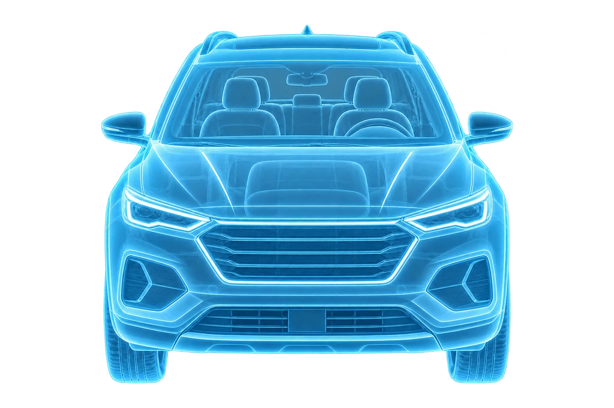

# راهنمای جامع استفاده، نصب و یکپارچه‌سازی Vehicle 360 Recorder V2

> نسخه مستند: V2 با هشت تصویر Ghost Guide از نوع WebP  
> زبان رابط: فارسی (RTL) — رنگ اصلی: `#2563EB` — طراحی موبایل‌فرست  
> وضعیت: نمونه مستقل قابل اجرا؛ **اتصال به پروژه اصلی و سرور هنوز جزو این بسته نیست**.

---

## ۱. این بسته دقیقاً چیست و چه کاری انجام می‌دهد؟

این بسته یک **ماژول مستقل Frontend برای ضبط ویدیوی پیوسته از اطراف خودرو** است. کاربر فقط با دوربینِ بازشده در مرورگر می‌تواند ضبط کند؛ انتخاب ویدیو از گالری یا فایل‌منیجر عمداً وجود ندارد. در تصویر زنده، یک راهنمای نیمه‌شفاف WebP از بدنه خودرو نمایش داده می‌شود و کاربر می‌تواند دستی بین ۸ نما جابه‌جا شود.

**قابلیت‌های موجود:** دریافت مجوز دوربین، پیش‌نمایش زنده، شروع/مکث/ادامه/پایان ضبط (بسته به پشتیبانی مرورگر)، عوض کردن دوربین قبل از شروع ضبط در دستگاه‌های چنددوربینه، تایمر زمان فعال، حلقه زمان پیشنهادی، بازبینی ویدیوی ضبط‌شده، ضبط مجدد، ذخیره `Blob` در `IndexedDB` و قرارداد اتصال به صف آپلود موجود پروژه.

**قابلیت‌های موجود نیست:** تشخیص خودکار زاویه یا پوشش ۳۶۰°، اعتبارسنجی بصری ویدیو، تضمین اصالت شواهد صرفاً با مرورگر، آپلود واقعی بدون اتصال bridge، API بک‌اند، و ادغام خودکار با مراحل احراز هویت و قفل ثبت نهایی محصول.

> «ضبط تکمیل شد» در نمونه به معنای ذخیره محلی ویدیو است؛ **نه لزوماً آپلود موفق یا تأیید کارشناس**.

## ۲. دانلود و ساختار پوشه‌ها

فایل بسته را از حالت ZIP خارج کنید. پوشه اصلی `vehicle-360-recorder-v2` است. فایل‌های مهم:

```text
vehicle-360-recorder-v2/
├── index.html                            # صفحه مستقل، دارای DOM موردنیاز ماژول
├── styles.css                            # ظاهر، RTL، 100dvh، Ghost و دکمه‌ها
├── package.json                          # اجرای تست‌های Node
├── README.fa.md                          # راهنمای سریع
├── DESIGN_GUIDE_FA.md                    # مستند تصمیم‌های بصری
├── IMPLEMENTATION_GUIDE_FA.md            # این راهنمای کامل
├── CHANGELOG-v2.fa.md
├── assets/360-recording/
│   ├── ghost-guides/
│   │   ├── ghost-front.webp
│   │   ├── ghost-front-45-right.webp
│   │   ├── ghost-right.webp
│   │   ├── ghost-rear-45-left.webp
│   │   ├── ghost-rear.webp
│   │   ├── ghost-rear-45-right.webp
│   │   ├── ghost-left.webp
│   │   ├── ghost-front-45-left.webp
│   │   ├── manifest.json                # فهرست نما و نام فایل‌ها
│   │   └── README.fa.md
│   └── icons/                             # آیکن‌های کنترلی SVG، نه Ghost
├── src/
│   ├── main.js                            # اتصال UI به کنترلر و رویدادها
│   ├── recorder-controller.js             # دوربین، MediaRecorder و ماشین وضعیت
│   ├── components/
│   │   ├── GhostVehicleOverlay.js
│   │   ├── GhostVisibilityToggle.js
│   │   ├── LiveCameraPreview.js
│   │   ├── CircularRecordingProgress.js
│   │   ├── RecordingTimer.js
│   │   ├── RecordingControls.js
│   │   └── CaptureGuidance.js
│   ├── storage/recordings-db.js           # IndexedDB ضبط‌ها
│   └── integration/upload-adapter.js      # رابط صف آپلود اپ میزبان
├── tests/
│   ├── components.test.mjs
│   └── smoke_test.py
└── mockups/                             # تصاویر طراحی و پیش‌نمایش‌ها
```

`mockups/` در جریان اجرایی دوربین استفاده نمی‌شود. برای Production نیازی به انتشار ماکاپ‌ها و فایل‌های تست نیست. `index.html` و `styles.css` و کل `src/` و `assets/360-recording/` برای اجرای نمونه لازم‌اند.

## ۳. راه‌اندازی در Windows 11 / VS Code

### مرحله اول: اجرای محلی

1. ZIP را استخراج کنید.
2. در VS Code گزینه **File → Open Folder** را بزنید و پوشه `vehicle-360-recorder-v2` را انتخاب کنید.
3. در Terminal (با قرار داشتن در ریشه این پوشه) اجرا کنید:

```powershell
python -m http.server 5500
```

4. در **همان کامپیوتر** آدرس زیر را باز کنید:

```text
http://localhost:5500
```

5. دکمه «فعال‌سازی دوربین» را بزنید و مجوز را تأیید کنید. داشتن وب‌کم در کامپیوتر برای تست ضبط لازم است.

در صورت نصب نبودن Python، می‌توانید از VS Code Live Server یا هر سرور فایل استاتیک استفاده کنید. `npm install` برای اجرای نمونه لازم نیست؛ برای اجرای تست‌ها باید Node.js نصب باشد.

**نکته HTTPS:** `http://localhost` برای توسعه روی همان دستگاه، secure context محسوب می‌شود؛ ولی بازکردن آدرس `http://192.168.x.x:5500` از طریق گوشی، معمولاً اجازه دوربین نمی‌دهد. برای تست موبایل از دامنه HTTPS، تونل HTTPS معتبر یا توسعه لوکال HTTPS استفاده کنید. اجرای مستقیم فایل با `file://` توصیه نمی‌شود.

### مرحله دوم: تنظیمات قابل تغییر

قبل از اسکریپت `src/main.js` در `index.html` این تنظیمات را بگذارید:

```html
<script>
  window.Vehicle360Config = {
    targetDurationMs: 60000, // هدف پیشنهادی: 60 ثانیه
    readOnly: false          // وقتی بازرسی نهایی شده: true
  };
</script>
<script type="module" src="./src/main.js"></script>
```

- `targetDurationMs` در نمونه حداقل ۱۵۰۰۰ میلی‌ثانیه در نظر گرفته می‌شود.
- هدف زمانی تنها **نوار پیشرفت زمان** است، نه محدودیت قطعی ویدیو.
- `readOnly` صرفاً وضعیت UI نمونه را قفل می‌کند؛ **اجازه تغییر داده باید در منطق اصلی برنامه و بک‌اند هم کنترل شود**.

## ۴. هشت تصویر Ghost Guide و جای استفاده از آن‌ها

| شماره در رابط V2 | زاویه از دید خود خودرو | فایل |
|---:|---|---|
| ۱ | جلو | `ghost-front.webp` |
| ۲ | جلو ۴۵ درجه راست | `ghost-front-45-right.webp` |
| ۳ | راست | `ghost-right.webp` |
| ۴ | عقب ۴۵ درجه چپ | `ghost-rear-45-left.webp` |
| ۵ | عقب | `ghost-rear.webp` |
| ۶ | عقب ۴۵ درجه راست | `ghost-rear-45-right.webp` |
| ۷ | چپ | `ghost-left.webp` |
| ۸ | جلو ۴۵ درجه چپ | `ghost-front-45-left.webp` |

مسیر پوشه کامل: `assets/360-recording/ghost-guides/`.

**زاویه «راست/چپ» متعلق به خودرو است، نه سمت راست/چپِ تصویر موبایل.** حتماً در تست چشمی این برچسب‌ها را با جهت خود خودرو مقایسه کنید. فایل‌ها یک SUV تصویری نمونه را نمایش می‌دهند و الزاماً هندسه و جزئیات کاملاً یکسان در تمام نماها ندارند. برای راهنمایی دقیق مخصوص یک مدل خودرو باید تصاویر جدید از یک مدل سه‌بعدی واحد رندر شوند.

### تفاوت «۸ زاویه» با مسیر فیزیکی دور خودرو

هشت تصویر، **۸ جهت با گام نظری ۴۵ درجه** را نشان می‌دهند؛ ولی ترتیب سفارشی شما یک مسیر پیاده‌روی پیوسته دور خودرو نیست. ترتیب همین فهرست در فایل `src/components/GhostVehicleOverlay.js` نگهداری شده است. اگر روزی بخواهید کاربر در یک جهت به‌طور پیوسته حرکت کند، ترتیب هندسی نمونه چنین است:

```text
جلو → جلو ۴۵ راست → راست → عقب ۴۵ راست → عقب
→ عقب ۴۵ چپ → چپ → جلو ۴۵ چپ → جلو
```

**در این پکیج ترتیب درخواستی شما تغییر داده نشده است.** جابه‌جایی زاویه‌ها فقط دستی است و به معنای ثبت‌شدن آن زاویه در ویدیو نیست.

### چطور Ghost در تصویر زنده نمایش داده می‌شود؟

در `GhostVehicleOverlay.js` یک `` با نام زاویه انتخاب‌شده ساخته می‌شود. `src/main.js` این عنصر را روی تصویر `<video>` دوربین قرار می‌دهد. نمونه کد ساده‌شده:

```html
<div class="camera-stage">
  <video autoplay muted playsinline></video>
  <div class="ghost-root">
    
  </div>
</div>
```

```css
.camera-stage { position: relative; overflow: hidden; }
.camera-stage video {
  width: 100%; height: 100%; object-fit: cover;
}
.ghost-root { position: absolute; inset: 0; pointer-events: none; }
.vehicle-ghost {
  width: 100%; height: 100%; object-fit: contain;
  opacity: 0.44; pointer-events: none;
}
```

کد بالا فقط **نمایش مفهومی مکانیزم** است؛ CSS اجرایی فعلی اندازه ناحیه امن را دقیق‌تر با `.ghost-layer` تنظیم می‌کند. برای تغییر اندازه و شفافیت، در `styles.css` مقادیر `.ghost-layer` و `.vehicle-ghost` را تنظیم کنید. تغییر بسیار زیاد opacity می‌تواند جلوی دیدن آسیب بدنه را بگیرد. `pointer-events:none` جلوی مسدود شدن لمس کنترل‌های دوربین را می‌گیرد.

**مهم:** چون `MediaRecorder` مستقیماً `MediaStream` را ضبط می‌کند، این لایه تصویری وارد فایل ویدیویی ذخیره‌شده نمی‌شود. اگر روزی تصویر دوربین را روی canvas ترکیب و ضبط کنید، باید مجدداً همین مسئله را بررسی کنید.

## ۵. اجزای اصلی برنامه و مسئولیت هر فایل

- `index.html`: صفحه مستقل و شناسه‌های DOM مثل `previewRoot`، `ghostRoot`، `controlsRoot` و `progressRoot`.
- `styles.css`: پوسته صفحه، راست‌به‌چپ، `100dvh`، موقعیت Ghost، responsiveness، نمایش حلقه و دکمه‌ها.
- `src/main.js`: کنترل رویدادهای دکمه‌ها و render مجدد ظاهر، تنظیمات، ناوبری دستی میان زاویه‌ها و hook بستن صفحه.
- `src/recorder-controller.js`: مجوز دوربین و `getUserMedia`، انتخاب MIME، `MediaRecorder`، مکث/ادامه، ایجاد `Blob`، تولید پیش‌نمایش و قبول/رد ضبط.
- `src/components/LiveCameraPreview.js`: عنصر `<video>` واقعی با `playsinline`، `autoplay` و `muted`.
- `src/components/GhostVehicleOverlay.js`: فهرست هشت جهت و مسیر تصویر WebP انتخاب‌شده.
- `src/components/GhostVisibilityToggle.js`: نمایش یا پنهان کردن Ghost بدون خاموش‌کردن دوربین.
- `src/components/RecordingTimer.js`: نمایش زمان ضبط فعال با ارقام فارسی.
- `src/components/CircularRecordingProgress.js`: محاسبه درصد زمان و رسم حلقه SVG سبک. **فایل Ghost از SVG نیست**؛ فقط حلقه و آیکن‌ها می‌توانند SVG باشند.
- `src/components/RecordingControls.js`: نمایش دکمه‌ها بر اساس حالت ضبط؛ هیچ file picker ندارد.
- `src/components/CaptureGuidance.js`: پیام‌های راهنمای ضبط.
- `src/storage/recordings-db.js`: دیتابیس محلی مستقل با نام `vehicle-inspection-360-capture` و store به نام `recordings`.
- `src/integration/upload-adapter.js`: پل بین ویدیوی پذیرفته‌شده و صف آپلود اصلی، فقط وقتی اپ میزبان آن را پیاده کرده باشد.

> این فایل‌ها **ماژول‌های JavaScript بدون فریم‌ورک** هستند. اگر اپ اصلی React/Vite/Next.js دارد، کپی‌کردن مستقیم `index.html` داخل یک Component کافی نیست؛ باید رفتارهای DOM و state در React یا در یک route ایزوله به‌درستی یکپارچه شوند.

## ۶. گردش کامل کاربر و وضعیت‌های فنی

```text
idle
  └─ فعال‌سازی دوربین → starting → ready
                                  └─ شروع ضبط → recording
                                                ├─ مکث → paused → ادامه → recording
                                                └─ پایان ضبط → stopping → review
                                                                             ├─ ضبط مجدد → idle
                                                                             └─ تأیید → saving → completed
هر حالت متناسب با رخداد → error / unsupported
وضعیت بازرسی نهایی‌شده → locked
```

1. کاربر وارد مرحله ویدیوی ۳۶۰° می‌شود؛ به‌صورت پیش‌فرض Ghost جلو نمایش داده خواهد شد، ولی تصویر واقعی هنوز نیاز به فعال‌سازی دوربین دارد.
2. مرورگر مجوز دوربین می‌خواهد. در صورت عدم مجوز یا ناسازگاری، پیام فارسی نمایش داده می‌شود؛ **آپلود فایل جایگزین نمی‌شود**.
3. کاربر ضبط را آغاز می‌کند؛ ویدیو مستقیماً در `MediaRecorder` ثبت می‌شود؛ پیش‌نمایش دوربین واقعی است.
4. کاربر اطراف خودرو حرکت می‌کند و با فلش‌ها زاویه راهنما را دستی تغییر می‌دهد. مخفی‌کردن Ghost ضبط را قطع نمی‌کند.
5. مکث/ادامه، اگر توسط مرورگر پشتیبانی شود، زمان فعال ضبط را متوقف/ادامه می‌کند.
6. با پایان ضبط، ویدیوی Blob برای بازبینی نمایش داده می‌شود؛ کاربر آن را رد و دوباره ضبط می‌کند یا تأیید می‌کند.
7. با تأیید، Blob در `IndexedDB` ذخیره می‌شود. سپس در صورت وجود bridge، برای صف durable آپلود میزبان درخواست enqueue صادر می‌شود.
8. با نبود bridge، فایل **فقط محلی** باقی می‌ماند. در reload بعدی، `resumePendingHandoffs()` تنها در صورتی سعی مجدد می‌کند که bridge پیش از اجرای `main.js` نصب شده باشد.

### مفهوم حلقه پیشرفت

```js
progressPercent = Math.min(elapsedActiveRecordingMs / targetDurationMs, 1) * 100;
```

- هنگام `paused` زمان تغییر نمی‌کند.
- با رسیدن به ۱۰۰٪ ضبط **خودکار تمام نمی‌شود**.
- اگر ویدیو در ۳۰ ثانیه پایان یابد و هدف ۶۰ ثانیه باشد، مقدار ۵۰٪ است؛ موفقیت ذخیره محلی ۵۰٪ زمان را به «پوشش تأیید شده» تبدیل نمی‌کند.
- این برنامه هیچ اعتبارسنجی خودکار ۳۶۰ درجه ندارد. حتی عبور دستی از هر هشت Ghost به معنی پوشش واقعی نیست.

### قالب و اندازه ویدیو

در `recorder-controller.js` انتخاب نوع ویدیو با `MediaRecorder.isTypeSupported()` به ترتیب اولویت‌های MP4/H.264 و WebM انجام می‌شود؛ فرمت نهایی تابع پشتیبانی مرورگر است. گزینه‌های دوربین فعلی `audio:false`، کیفیت ایده‌آل 1280×720 و 30fps هستند؛ این اعداد تضمین کیفیت واقعی نیستند. اگر اپ مجبور به ضبط عمودی یا codec خاصی باشد، در برنامه اصلی باید بر اساس دستگاه، قوانین بک‌اند و سرور آپلود تصمیم بگیرید. فرض نکنید همه iPhoneها و Androidها یک نوع فایل می‌دهند.

## ۷. چطور ماژول را وارد اپلیکیشن اصلی بازدید خودرو کنیم؟

### مسیر پیشنهادی: ادغام کنترل‌شده در Worktree پایدار

برای اینکه روی جریان فعال دوبعدی و شاخه اختیاری سه‌بعدی تأثیر ناخواسته نگذارید:

1. اول با Git وضعیت پروژه و فایل‌های ویرایش‌نشده را بررسی کنید؛ **worktree نهایی را از روی نام حدس نزنید**. `git status`, `git branch -vv`, `git log -5 --oneline` و `git worktree list` را در مخزن اجرا کنید.
2. یک شاخه/Worktree ویژگی جدا از مبنای پایدار واقعی برنامه ایجاد کنید؛ تغییرات کاربر را قبل از این کار حفظ کنید.
3. فایل‌های `assets/360-recording/` را در مسیر public/static صحیح فریم‌ورک میزبان قرار دهید.
4. `src/components` و `src/recorder-controller.js` را به صفحه ضبط برنامه وصل کنید. اگر React استفاده می‌کنید، listenerها و lifecycle مربوط به stream و object URL را در hookها مدیریت کنید.
5. استایل‌ها را به‌شکل scopeشده به صفحه ضبط منتقل کنید تا selectorهای عمومی `button`, `body` یا `.app-shell` با صفحات دیگر تداخل نکنند. RTL و `100dvh` اپ اصلی را حفظ کنید.
6. DOM لازم از `index.html` را در صفحه میزبان ایجاد کنید یا آن را به ساختار Componentهای اصلی تبدیل کنید.
7. ابتدا رفتار camera-only و WebP Ghost را بدون بک‌اند آزمایش کنید؛ سپس bridge صف آپلود را وصل کنید.
8. وضعیت ثبت نهایی، اطلاعات خودرو/مشتری/inspection، قوانین اجباری و لغو کار آپلود نسخه قبلی را هماهنگ کنید.
9. بعد از تست روی موبایل، ماکاپ و اسکرین‌شات واقعی را کنار هم مقایسه کنید؛ سپس PR مستقل بدهید.

**روش سریع برای نمایش دموی مستقل**: می‌توان همان پوشه را تحت یک مسیر مجزا از سرور سایت منتشر کرد. این کار صفحه را به اپ میزبان «وصل» نمی‌کند؛ مسیریابی برگشت، نشست، داده‌های بازرسی و upload queue همچنان باید یکپارچه شوند. درج آن داخل `<iframe>` هم بدون `Permissions-Policy` و `allow="camera"` ممکن است دسترسی دوربین را قطع کند، بنابراین انتخاب اول برای Production نیست.

### نکته مهم درباره مسیر asset در React/Vite

در `GhostVehicleOverlay.js` مسیر فعلی **نسبت به صفحه** تعریف شده است:

```js
const root = './assets/360-recording/ghost-guides/';
```

وقتی صفحه با مسیری مثل `/inspection/123/video` باز شود، این آدرس ممکن است به مسیر اشتباه resolve شود. بعد از انتقال فایل‌ها به پوشه public برنامه، با توجه به `base path` و router، آدرس صحیح را تعیین کنید (برای مثال در پروژه‌ای که از root منتشر می‌شود: `/assets/360-recording/ghost-guides/`). از hardcode ریشه `/` در برنامه‌ای که زیرمسیر deploy می‌شود، بدون بررسی base URL خودداری کنید. این موضوع برای مسیر آیکن‌ها هم صادق است.

## ۸. اتصال به IndexedDB، صف آپلود و فازهای قبلی

### ذخیره محلی فعلی

فایل `src/storage/recordings-db.js` یک دیتابیس مستقل با رکوردهایی شبیه این ایجاد می‌کند:

```js
{
  id: 'uuid-for-this-recording',
  blob: /* Blob اصلی */,
  mimeType: 'video/webm', // مقدار نمونه، واقعی ممکن است MP4 باشد
  durationMs: 65000,
  createdAt: '2026-10-14T...',
  evidenceType: 'walkaround-360',
  origin: 'in-app-camera',
  uploadStatus: 'pending-handoff'
}
```

بعد از ثبت موفق در صف آپلود، status محلی `queued` و `jobId` ثبت می‌شود. به دلیل ساختار مستقل DB، این **به معنای ادغام خودکار با IndexedDB کنونی اپ نیست**. در محصول واقعی باید روشن شود کدام جدول/store مالک نهایی فایل و metadata است، چگونه بازبینی ویدیو از بارگذاری دوباره ادامه می‌یابد، و چگونه هنگام تعویض ویدیو فایل قبلی و jobهای کهنه لغو یا پاکسازی می‌شوند.

### قرارداد bridge موجود در پکیج

`src/integration/upload-adapter.js` قبل از enqueue به این شیء جهانی مراجعه می‌کند:

```js
window.VehicleInspectionUploadBridge = {
  async enqueueRecordedWalkaround({
    recordingId, blob, mimeType, durationMs, evidenceType
  }) {
    // اینجا با صف آپلود واقعی و موجود اپ تماس بگیرید.
    // صف باید persist، dedupe و idempotency داشته باشد.
    // پس از ثبت موفق در صف، شناسه همان job را برگردانید.
    return { jobId: 'ID-RETURNED-BY-REAL-QUEUE' };
  }
};
```

**کد بالا فقط نمونه قرارداد است و خودِ صف واقعی را پیاده‌سازی نمی‌کند.** `return` ساختگی را در Production باقی نگذارید، چون به‌اشتباه علامت «queued» ثبت می‌شود. پیاده‌سازی واقعی باید:

- قبل از بارگذاری `src/main.js` آماده شود.
- شناسه بازرسی و مشتری معتبر را از context احراز‌شده اپ بگیرد؛ این دو داده داخل آرگومان bridge نمونه وجود ندارند.
- دقیقاً از صف durable آپلود قبلی استفاده کند، نه یک `fetch` گذرای مستقل.
- برای `recordingId` و revision فایل، **کلید یکتا و تکرارناپذیر** بسازد. `resumePendingHandoffs()` ممکن است بعد از کرش همان شواهد را دوباره enqueue کند.
- reupload/replacement را با قرارداد cancellation و revision فعلی هماهنگ کند.
- در شرایط offline کار را پایدار نگه دارد و retry/backoff، lease و concurrency صف فعلی را خراب نکند.
- تنها وقتی صف **پایدار** job را پذیرفت `{jobId}` واقعی برگرداند و در خطا `throw` کند.
- داده `durationMs` و `mimeType` را همراه metadata بفرستد. تشخیص نوع فایل صرفاً از پسوند انجام نشود.
- «queued / uploaded / processing / verified / failed» را از وضعیت **واقعی صف و سرور** نمایش دهد، نه از `completed` در UI ضبط.

### حداقل قرارداد سمت بک‌اند؛ پیشنهاد برای هماهنگی، نه API موجود

بسته **هیچ endpoint موجود بک‌اند را تعریف نمی‌کند**. تیم Frontend و ASP.NET Core باید درباره مراحل **رزرو/ساخت شواهد، ارسال فایل و نهایی‌سازی، وضعیت پردازش و جایگزینی ویدیو** با APIهای واقعی موجود توافق کنند. در صورت نیاز به طراحی جدید، ورودی‌ها و خروجی‌های حداقلی عبارت‌اند از:

| عملیات پیشنهادی | داده‌های لازم | انتظار |
|---|---|---|
| ایجاد/ثبت شواهد ویدیو | `inspectionId`، نوع `walkaround-360`، `revision`، `recordingId` | شناسه evidence/job تکرارناپذیر |
| ارسال ویدیو | binary فایل با `mimeType` معتبر، metadata، مجوز | ذخیره امن در فضای خصوصی سرور؛ پشتیبانی از retry/idempotency |
| تکمیل و تأیید دریافت | شناسه شواهد و checksum/size در صورت الزام | وضعیت آپلود و مسیر خصوصی یا شناسه فایل |
| مشاهده وضعیت | inspection/evidence/job id | queued/uploaded/processing/verified/failed یا وضعیت‌های واقعی محصول |
| جایگزینی ویدیوی قبلی | inspectionId، revision جدید | جلوگیری از فعال ماندن job قدیمی؛ مطابق منطق موجود |

این جدول **طرح قرارداد پیشنهادی** است و نباید به‌عنوان URL یا route واقعی Swagger پروژه تلقی شود.

### محل فایل در سرور و پایگاه داده

طبق نیازمندی محصول بازدید خودرو: API ASP.NET Core باید باینری را در فضای فایل **خصوصی** با تفکیک مشتری و بازرسی نگه دارد، مثلاً:

```text
private-inspections/
└── GUI_{CustomerId}/
    └── {InspectionId}/
        └── walkaround-360-rev-{revision}.{ext}
```

این **الگوی پیشنهادی مسیر** است؛ مکان دقیق و مجوزها را تیم سرور تعیین می‌کند. دیتابیس MSSQL مربوط به کارگزاری فقط مسیر/شناسه فایل نهایی و metadata را ثبت می‌کند، نه Blob یا باینری ویدیو. از نام فایل دریافتی کاربر برای ساخت مسیر سرور بدون اعتبارسنجی استفاده نکنید. frontend کلید خصوصی صدور Bearer token را نگهداری نمی‌کند؛ اتصال به API باید مطابق مکانیزم امن نشست و BFF/API فعلی باشد.

## ۹. هماهنگی با قوانین بازرسی فعلی

هنگام ادغام با جریان ۱۲ عکس ضروری، کیلومتر ثبت‌شده و ویدیوی ۳۶۰ درجه:

- ضبط ۳۶۰ درجه فقط **یک evidence مستقل از عکس‌ها و عدد کیلومتر** است؛ در شمارنده عکس‌ها وارد نشود.
- وضعیت `completed` صرفاً پایان ضبط/ذخیره محلی را نشان می‌دهد؛ برای Submit نهایی باید از شرط‌های سرور و سیاست موجود درباره حداقل حالت آپلود استفاده شود.
- بعد از Submit نهایی، ویرایش تصویر، ویدیو، کیلومتر و لوکیشن باید هم در UI و هم در کنترل‌های داده قفل باشد. `readOnly` نمونه کافی نیست.
- در retake بعد از enqueue، به نسخه قبلی و منطق stale job cancellation توجه کنید. **کد نمونه خودش فایل ذخیره‌شده قبلی را حذف یا job قبلی را cancel نمی‌کند**.
- کپی‌کردن DB جدید در اپ موجود ممکن است ذخیره تکراری به‌وجود آورد؛ قبل از Production مالکیت Blob و cleanup را یکپارچه کنید.

## ۱۰. نکات امنیت، پایداری و کارایی

- **Camera-only ≠ اثبات اصالت:** حذف file picker جلوی واردکردن فایل آماده در UI را می‌گیرد، اما جلوی دستکاری توسط محیط مرورگر دستکاری‌شده یا ابزارهای توسعه را به‌تنهایی نمی‌گیرد. برای اصالت قوی‌تر نیاز به پروتکل تأیید سرور است.
- **HTTPS/permission:** `getUserMedia` به secure context و مجوز نیاز دارد؛ خطا باید خوانا باشد.
- **دسترسی محدود:** `audio:false` در نمونه صدا ضبط نمی‌کند. تغییر این سیاست باید با توافق محصول و حریم خصوصی انجام شود.
- **فضای ذخیره:** فایل ویدیویی ممکن است حجیم شود و `IndexedDB` ممکن است با quota، پاک‌سازی storage یا حالت خصوصی مرورگر محدود شود. درصد آپلود را با درصد ضبط اشتباه نگیرید.
- **کرش در میانه ضبط:** ذخیره این نسخه **بعد از تأیید ضبط** اتفاق می‌افتد؛ تضمین نجات ویدیوی ناقص در اثر بستن ناگهانی تب یا خاموش‌شدن گوشی وجود ندارد.
- **مدیریت stream:** هنگام خروج از صفحه، تغییر route و unmount باید `window.Vehicle360Recorder.dispose()` یا cleanup معادل صدا زده شود تا trackهای دوربین بسته شوند.
- **Browser MIME:** روی Safari iOS و Chrome Android خروجی MP4/WebM، playback و acceptance سرور را جداگانه آزمایش کنید.
- **مسیر فایل:** اگر اپ PWA دارای Service Worker است، نسخه‌گذاری تصاویر و cleanup کش قدیمی را بررسی کنید تا Ghostهای قبلی نمایش داده نشوند.
- **راهنمای زاویه:** با `pointer-events:none` باید لمس دکمه‌ها آزاد باشد؛ تصویر در مرورگر نباید کج، کشیده یا به‌اشتباه آینه شود.
- **قاب‌بندی:** `video {object-fit:cover}` ممکن است بسته به نسبت ابعاد دوربین بخشی از کادر را ببرد. WebP راهنما `contain` است؛ باید روی موبایل‌های هدف به شکل بصری تنظیم شود.

## ۱۱. تست‌ها و معیار پذیرش قبل از انتشار

### تست‌های خودکار موجود

```bash
npm test
```

شامل ۶ تست واحد برای تایمر، قفل درصد، ثابت‌ماندن زمان در مکث، وجود هشت فایل WebP، نبود مسیر فایل‌پیکر و ادعانکردن پوشش تأییدشده است. این تست‌ها کیفیت دوربین، صحت تصویری هر زاویه، اتصال به صف واقعی یا پردازش سرور را آزمایش نمی‌کنند.

تست smoke مرورگر (نیازمند نصب جداگانه Playwright، Chromium و اجرای سرور):

```bash
python -m pip install playwright
python -m playwright install chromium
python tests/smoke_test.py
```

### چک‌لیست دستی روی گوشی Android و iPhone

- [ ] بدون HTTPS یا بدون مجوز، پیام درست نمایش داده شود؛ مسیر واردکردن فایل ظاهر نشود.
- [ ] بعد از دادن مجوز، فقط جریان واقعی دوربین دیده شود.
- [ ] هشت Ghost تصویر متفاوت داشته باشند و label زاویه از دید خودرو صحیح باشد.
- [ ] Ghost قابل خاموش/روشن‌کردن باشد و مزاحم لمس نباشد.
- [ ] Ghost در **ویدیوی پخش‌شده پس از ضبط** ظاهر نشود.
- [ ] صفحه در ارتفاع‌های کوتاه بدون overflow کل Document و کنترل‌های خارج از دسترس کار کند.
- [ ] زمان در مکث ثابت بماند و بعد از ادامه افزایش یابد.
- [ ] پس از ۶۰ ثانیه ضبط خودکار قطع نشود و «پوشش کامل تأیید شد» نمایش داده نشود.
- [ ] stop، review، retake، accept و ذخیره در IndexedDB کار کنند.
- [ ] آپلود پس از accept، در حالت آنلاین/آفلاین و پس از reload، از مسیر صف اصلی انجام شود.
- [ ] با جایگزینی ویدیو، job قبلی مطابق revision کنسل/نامعتبر شود.
- [ ] بعد از Submit، امکان تغییر شواهد ویدیو وجود نداشته باشد.
- [ ] مرورگر بعد از بستن صفحه دوربین را آزاد کند.
- [ ] ویدیوی واقعی با MIME مربوط در سرور قابل پخش/پردازش باشد و مسیر آن در MSSQL ذخیره شود.

### محدوده آزمایش تأییدشده هنگام تولید بسته

تست‌های واحد Node قبلاً اجرا شده‌اند. به دلیل محدودیت محیط ایجاد بسته، تست واقعی `getUserMedia` / `MediaRecorder` روی گوشی و بررسی screenshot مرورگر اپ اصلی **تأیید نشده** است. پس انتشار به Production منوط به تست موارد بالا است.

## ۱۲. خطاهای متداول و روش عیب‌یابی

| مشکل | دلیل احتمالی | راه‌حل |
|---|---|---|
| دوربین روشن نمی‌شود | `file://`، HTTP غیر امن، مرورگر ناسازگار، مجوز رد شده | HTTPS/localhost روی همان دستگاه، تنظیمات permission، تست مرورگر به‌روز |
| WebP نمایش داده نمی‌شود | مسیر نسبی asset در SPA اشتباه است | Network/404 و Base URL را بررسی کنید؛ تصویر را مستقیم باز کنید |
| زاویه راست/چپ برعکس است | تعریف سمت از دید نمایشگر به‌جای خودرو | label و asset را با جهت فیزیکی خودرو بررسی کنید؛ به شکل کور تصویر را mirror نکنید |
| Ghost خیلی پررنگ یا کم‌رنگ است | CSS opacity یا روشنایی تصویر | `.vehicle-ghost {opacity: .44}` را بر اساس نمونه واقعی تنظیم کنید |
| ویدیو در بازبینی پخش نمی‌شود | MIME/codec ناسازگار | خروجی `mediaRecorder.mimeType` را روی همان دستگاه و سرور بررسی کنید |
| ضبط ذخیره شد ولی آپلود نشد | bridge نصب نیست/صف خطا داده | قبل از `main.js` bridge واقعی نصب شود؛ صف و pending handoffs را بررسی کنید |
| چند job برای یک ویدیو ساخته می‌شود | صف idempotent نیست | dedupe با `recordingId` و revision؛ بازیابی بعد از کرش را تست کنید |
| ویدیو هنگام reload از دست می‌رود | ضبط هنوز تأیید/ذخیره نشده بود | این نسخه ذخیره میان‌ضبط تضمین نمی‌کند؛ workflow و محدودیت‌ها را توضیح دهید |
| بعد از retake هنوز نسخه قدیمی فعال است | cancellation با صف ادغام نشده | stale job cancellation و revision مدیریت شود |
| UI در گوشی بریده می‌شود | ارتفاع کوچک، safe-area، CSS global اپ میزبان | `100dvh`, `env(safe-area-inset-bottom)` و scope کردن CSS را بررسی کنید |

## ۱۳. ترتیب کار پیشنهادی برای تحویل محصول

1. **فاز A — آزمایش مستقل:** نمونه روی localhost، تست ۸ WebP و دوربین؛ بررسی طراحی در موبایل.
2. **فاز B — اتصال UI:** انتقال به worktree پایدار و route صفحه ویدیو؛ تطبیق RTL، 100dvh و کیفیت بصری.
3. **فاز C — ذخیره شواهد:** ایجاد ارتباط با context واقعی Inspection و store اصلی اپ؛ مدل داده، replace و read-only.
4. **فاز D — صف آپلود:** پیاده‌سازی bridge به queue موجود، قابلیت resume، idempotency، cancellation و نمایش وضعیت واقعی.
5. **فاز E — API:** تست فایل خصوصی روی سرور ASP.NET Core، metadata/MSSQL، وضعیت پردازش، قفل نهایی.
6. **فاز F — QA:** تست واقعی iOS/Android، offline/online، توقف ناگهانی، quota، کیفیت ضبط و مقایسه UI با ماکاپ.

## ۱۴. مواردی که از تیم بک‌اند/سورس اپ لازم است

برای یکپارچه‌سازی واقعی، این داده‌ها باید از پروژه به‌دست بیایند؛ از این پکیج به‌تنهایی قابل استخراج نیستند:

- نام و امضای **تابع queue موجود** و Store فایل‌های media؛ ساختار revision/job و روش cancellation.
- Context احراز‌شده مشتری و بازرسی: `CustomerId`, `InspectionId` و نحوه اتصال به evidence.
- API و قوانین فعلی ثبت شواهد، ارسال فایل، retry/resume، MIME قابل قبول، اندازه ویدیو و محدودیت زمانی.
- قرارداد قفل بعد از submit و اینکه چه وضعیتی برای submit کافی است.
- سیاست سرور برای قرار دادن فایل در `GUI_{CustomerId}`، زیرپوشه inspection، مسیر نهایی و metadata در MSSQL.
- مسیر route و فریم‌ورک اصلی اپ، سیاست service worker/cache و سازگاری مرورگرها.

---

### جمع‌بندی اجرایی

از این بسته می‌توان بلافاصله به‌عنوان **دموی دوربین و راهنمای قاب‌بندی هشت‌زاویه‌ای** استفاده کرد. تبدیل آن به یک قابلیت Production در پروژه بازدید خودرو نیازمند وصل‌کردن `src/integration/upload-adapter.js` به **صف آپلود موجود**، متصل‌کردن context بازرسی، همگام‌کردن قوانین submit/lock و انجام تست واقعی موبایل و بک‌اند است. هیچ بخشی از ادغام انجام‌نشده را نباید به‌عنوان قابلیت نهایی معرفی کرد.
